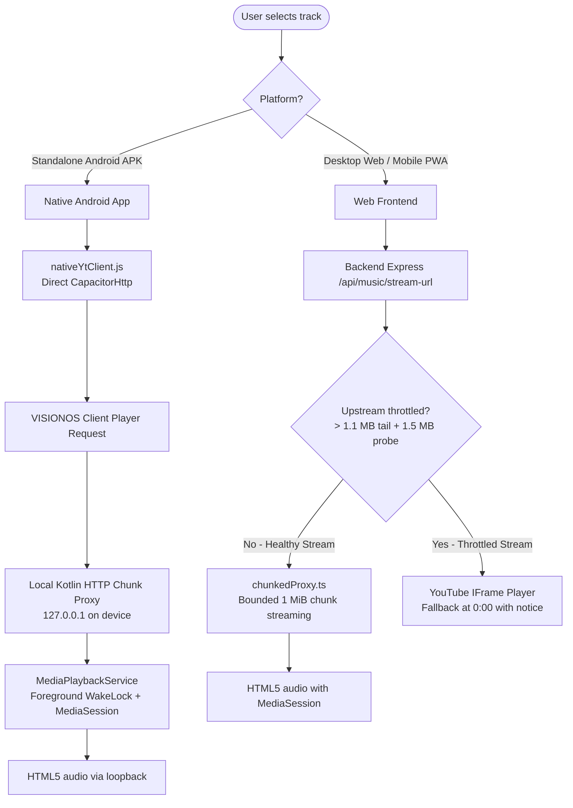

# Super Culture v2

> A personal, glassmorphic music streaming platform powered by YouTube's audio engine and AI curation — available as a responsive Web/PWA application and a 100% standalone native Android app.

---

## ✨ Features

- **Personalized AI Magic Vibe DJ**: Powered by Google Gemini GenAI, creating personalized vibe-matched playlists, transition mixes, and mood-adaptive curation.
- **Color-Extracted Audio Auras**: Dynamic, aesthetic aura visualizations generated from your listening history, genre distributions, and liked music.
- **OLED Glassmorphic UI**: Ultra-clean dark aesthetic with fluid animations, interactive gestures, and responsive spatial navigation.
- **Mobile-First Experience & PWA**: Mobile mini-player expanding to a full-screen swipeable Now Playing sheet, $\ge 44\text{px}$ touch targets, safe-area inset preservation, and installable as a standalone Progressive Web App.
- **Standalone Native Android App**: Runs 100% independently on Android devices via Capacitor with the laptop backend turned completely **OFF** (on-device `VISIONOS` stream resolver, local Kotlin chunk proxy, and offline library persistence).
- **Native Android Foreground Service & Lock-Screen MediaSession**: Background playback powered by `MediaPlaybackService.kt` with a `Notification.MediaStyle` notification, `PARTIAL_WAKE_LOCK`, `WifiLock`, interactive Previous / Play / Pause / Next / Seek controls, and asynchronous album art fetching.
- **Synchronous Zero-Await Next-Track Transitions**: Background pre-resolution (`preloadNextStreamUrl`) eliminates network `await` latency on `ended` events, ensuring uninterrupted auto-advance with the screen locked.
- **Dual Playback Engine with Intelligent Fallback**: High-performance HTML5 `<audio>` engine paired with an automatic headless YouTube IFrame compatibility fallback for upstream throttled streams.
- **Single-Port Architecture**: Express serves the compiled React single-page app, REST endpoints, and stream proxy from a single port (`5001`).
- **Multi-Tier Caching & SWR**: Stale-While-Revalidate caching across home shelves, discographies, and up-next queues, plus 30-minute negative caching for throttled streams.
- **Hardened Security & Resource Quotas**: Strict CORS allowlists with LAN/Tailscale origin matching (`ALLOW_PRIVATE_NETWORK_ORIGINS`), signed HMAC 5-minute stream tokens, optional cookie-backed passcode gate, rate limiting, and daily AI cost caps.

---

## 🏗️ Architecture & Playback Engines

Super Culture adapts dynamically to its runtime environment to deliver reliable, high-fidelity playback across mobile, web, and native devices:



### 1. Standalone Native Android App
When running inside the Capacitor Android container (`Capacitor.isNativePlatform()` is `true` and no external `VITE_API_URL` is set):
- **On-Device Stream Resolution (`nativeYtClient.js`)**: Fetches watch-page `visitorData` and issues direct calls to YouTube's `/youtubei/v1/player` using the unthrottled `VISIONOS` client via native `CapacitorHttp`, completely bypassing CORS.
- **Local Loopback Chunk Proxy (`LocalStreamProxy.kt`)**: Mobile WebViews reject custom `User-Agent` headers and issue open-ended `Range: bytes=0-` requests that YouTube CDN drops with `403 Forbidden`. The Android app starts a lightweight local loopback server on `127.0.0.1`, probes the stream length, and streams bounded 1 MiB chunks with the matching `VISIONOS` user agent.
- **Foreground Service & OS MediaSession (`MediaPlaybackService.kt`)**: Acquires `PowerManager.PARTIAL_WAKE_LOCK` and `WifiLock` to prevent the OS from suspending the CPU/WebView when the screen locks. Manages an Android `MediaSession` and system notification with lock-screen scrubbing (`ACTION_SEEK_TO`) and compact media controls.
- **Synchronous Auto-Advance**: Preloads the next track's stream URL into memory (`preloadNextStreamUrl`) so that when the current track finishes, `audio.src = url; audio.load(); audio.play()` executes synchronously with **zero async network hops** before playback starts.
- **Offline Persistence**: Liked songs, custom playlists, and vibe preferences persist locally in browser storage, functioning without an external backend.

### 2. Web `<audio>` Engine (Standard Web & PWA)
- Streams audio through the HTML5 `<audio>` element via the Node.js backend chunk proxy (`/api/yt/stream/:videoId?t=<signed_hmac>`).
- Features HMAC token expiration (5 minutes), byte-range seeking (HTTP 206 Partial Content), lock-screen Media Session controls, and zero-await next-track preloading.

### 3. YouTube IFrame Compatibility Fallback
- Upstream YouTube streams subject to Proof-of-Origin (PO) token throttling are detected during resolution via tail and 1.5 MiB secondary byte probes.
- Throttled tracks are routed immediately at `0:00` to the headless YouTube IFrame player with an in-app compatibility notice, eliminating mid-song cutoffs.
- *Note*: While in IFrame compatibility mode on web browsers, lock-screen/background playback is unavailable due to browser restrictions on background iframe execution.

---

## 📋 Prerequisites

- **Node.js**: `v20.0.0` or higher recommended (minimum `v18.0.0`) and `npm`
- **Android Development (Optional, for Android APK)**:
  - **JDK 21**: Java Development Kit 21
  - **Android SDK**: API level 34+ (`targetSdkVersion 36`, `minSdkVersion 24`)
  - **Android Studio** or command-line tools (`sdkmanager`, Gradle)
- **Docker (Optional)**: Docker Engine 20+ and Docker Compose

---

## 💻 Quickstart (Web Development)

### Concurrent Mode (Hot Module Replacement)

```bash
# 1. Clone repository
git clone https://github.com/ekanshs25160-bit/super-culture-v2.git
cd super-culture-v2

# 2. Configure environment
cp .env.example .env

# 3. Install dependencies
cd backend && npm install
cd ../frontend && npm install

# 4. Start backend (Terminal 1 - port 5001)
cd backend && npm run dev

# 5. Start frontend (Terminal 2 - port 3000)
cd frontend && npm run dev
```

Visit `http://localhost:3000` to start using the app with live HMR.

### Single-Port Production Mode (Local)

Run the unified Node.js server serving both backend API and built frontend static assets:

```bash
# 1. Build frontend
cd frontend && npm run build

# 2. Build and start backend
cd ../backend && npm run build
npm start
```

Visit `http://localhost:5001`.

---

## 📱 Building the Standalone Android APK

The standalone Android APK runs independently with full lock-screen background playback, MediaSession notifications, and local stream proxying:

```bash
# 1. Build frontend distribution bundle (without forcing external API URL)
cd frontend
env -u VITE_API_URL npm run build

# 2. Sync web assets and plugins to Android project
npx cap sync android

# 3. Compile Debug APK with Gradle
cd android
./gradlew assembleDebug
```

The resulting APK will be generated at:
```text
frontend/android/app/build/outputs/apk/debug/app-debug.apk
```

To install directly to a connected Android phone or emulator with USB debugging enabled:
```bash
adb install -r app/build/outputs/apk/debug/app-debug.apk
```

---

## 🔒 Privacy & Data Handling

**Stored locally on your device** (browser storage / app sandbox): playlists, liked tracks, the playback queue and position, app settings, and a short-lived `visitorData` cache used to talk to YouTube. Nothing else is persisted.

**Standalone Android app:** the phone connects **directly** to YouTube (`youtube.com`, `music.youtube.com`, and `*.googlevideo.com` for audio) through an on-device resolver and a loopback-only stream proxy (`127.0.0.1`, protected by a per-launch secret and a strict `googlevideo.com` allowlist). There is **no intermediate tracking or analytics server**. Android cloud auto-backup is disabled (`android:allowBackup="false"`), so local data is never uploaded to Google Drive backups.

**Update checks:** the app optionally queries the public GitHub Releases API (`VITE_GITHUB_REPO`, cached for 12 hours) to tell you when a new APK is available; no personal data is sent.

---

## 🚀 Releasing the Android APK

Pushing a tag such as `v1.0.1` runs [`.github/workflows/android-release.yml`](.github/workflows/android-release.yml): tests → frontend build → `cap sync` → signed `assembleRelease` → APK attached to the GitHub Release. Configure these repository secrets for a properly signed build (without them the APK falls back to debug signing):

| Secret | Purpose |
|:---|:---|
| `ANDROID_KEYSTORE_BASE64` | Base64-encoded release keystore (`base64 -i release.keystore`) |
| `ANDROID_KEYSTORE_PASSWORD` | Keystore password |
| `ANDROID_KEY_ALIAS` | Key alias |
| `ANDROID_KEY_PASSWORD` | Key password (defaults to the keystore password) |

The app version shown in **Settings → App Updates** comes from `frontend/package.json`; keep it in sync with the release tag.

---

## 🐳 Quickstart (Docker)

Spin up the entire application using the single-port production Docker container:

```bash
# 1. Build container image
docker build -t super-culture-v2 .

# 2. Run container
docker run -d \
  --name super-culture \
  -p 5001:5001 \
  -v $(pwd)/backend/data:/app/backend/data \
  --env-file .env \
  super-culture-v2
```

Navigate to `http://localhost:5001`.

---

## 🧪 Testing & Verification

Super Culture features automated end-to-end and unit test suites across backend, frontend, and native bridge components:

```bash
# Run Backend Test Suite (37 tests: CORS, rate-limits, signed tokens, throttling probes, caching)
npm test --prefix backend

# Build Backend TypeScript
npm run build --prefix backend

# Run Frontend Test Suite (62 tests: preloading, native resolver, fallback, store, transitions)
npm test --prefix frontend

# Lint Frontend Codebase
npm run lint --prefix frontend

# Build Frontend Production Assets
npm run build --prefix frontend

# Verify Android Native Build
cd frontend/android && ./gradlew assembleDebug
```

---

## ⚙️ Environment Variables

Configure application settings in `.env` (refer to [`.env.example`](file:///Users/ekanshshrotriya/Documents/super-culture-v2/.env.example)):

| Variable | Required | Default | Description |
|:---|:---:|:---:|:---|
| `PORT` | Optional | `5001` | HTTP server port for Express backend |
| `NODE_ENV` | Optional | `development` | Set to `production` for containerized runs to enforce secure cookies |
| `CORS_ORIGIN` | Optional | `https://super-culture-v2.onrender.com,http://localhost:3000` | Comma-separated allowlist of web origins |
| `ALLOW_PRIVATE_NETWORK_ORIGINS` | Optional | `false` | When `true` (always enabled in development), allows CORS from private IPv4 (`10.*`, `192.168.*`, `172.16-31.*`), Tailscale (`100.64-127.*`, `*.ts.net`), and mDNS (`*.local`) for phone testing over LAN |
| `APP_PASSCODE` | Optional | `""` | Shared passcode gating all `/api` routes with signed HTTP-only cookies |
| `COOKIE_SECRET` | Optional | Auto-derived | Secret key used to sign authentication cookies |
| `STREAM_SECRET` | Optional | Auto-derived | HMAC secret for signing 5-minute audio streaming tokens |
| `MAX_AI_CALLS_PER_DAY` | Optional | `100` | Global daily quota cap for Gemini AI calls to prevent overruns |
| `GEMINI_API_KEY` | Optional | `""` | Google Gemini API key for Magic Vibe generation and AI DJ curation |
| `DB_PATH` | Optional | `data/super_culture.db` | SQLite database file location |
| `VITE_GITHUB_REPO` | Optional (frontend) | `ekanshs25160-bit/super-culture-v2` | `owner/repo` queried for in-app update checks |

---

## 🚀 Render / Cloud Deployment Guide

The backend is optimized for zero-cost deployment on platforms like Render:

### 1. Free-Tier Cold-Start Handling
- **Sleep Cycle**: Free tier instances spin down after 15 minutes of inactivity. Fresh container spin-up takes ~30–60 seconds.
- **Client Wake Ping**: The web app dispatches a background `GET /health` call on load to initiate container wake-up before audio interaction.
- **Skeleton State Notification**: If an initial data fetch takes $>3\text{s}$, an ambient notification indicates the server is waking up.
- **Cache Pre-warming**: On boot, the backend immediately warms the home shelves cache to minimize first-request latency.

### 2. Recommended Hosting Region
- **Primary**: **`Oregon (US West)`** (`us-west-1`) — Upstream YouTube Music and Gemini APIs exhibit lowest transit latency and fewest IP blocks from US West data centers.
- **Alternative**: **`Frankfurt (EU Central)`** (`eu-central-1`) for European audiences.

### 3. Health & Readiness Probes
- **Liveness Probe**: `GET /health` — Lightweight HTTP 200 `{ status: "ok" }` without database or external network overhead.
- **Readiness Probe**: `GET /ready` — Validates active SQLite database connectivity.

---

## ⚠️ Disclaimer

Super Culture v2 is an experimental, personal open-source software project built strictly for personal use, education, and portfolio showcase purposes.

- Audio resolution and metadata discovery utilize the open-source `youtubei.js` library.
- Audio streaming is subject to YouTube's Terms of Service.
- No copyrighted media files are hosted or permanently stored on this server; the application proxies publicly accessible streams for personal listening.
- All trademarks, logos, and artist brand assets belong to their respective copyright holders.
